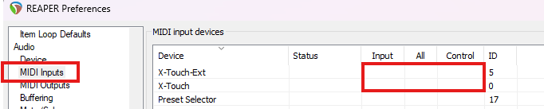
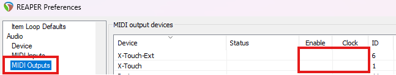
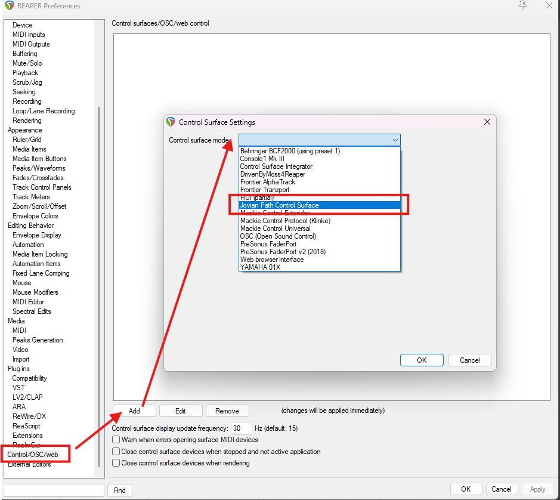
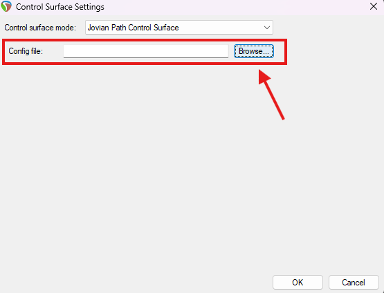

# JPRSurf User Guide

JPRSurf is a REAPER control surface extension. Everything a surface does comes
from its config file: which devices it uses, what each of their controls does,
and the modes that change that. This guide covers setting JPRSurf up in REAPER
and giving it a config file. What a config can say is in the [config
spec](config_spec.md), and the [example configs](#example-configs) are
complete surfaces to use as they are, or start your own from.

---

## Contents

- [Supported hardware](#supported-hardware)
- [Installing the extension](#installing-the-extension)
- [Turning off REAPER's own MIDI handling](#turning-off-reapers-own-midi-handling)
- [Adding the control surface](#adding-the-control-surface)
- [Choosing the config file](#choosing-the-config-file)
- [If something doesn't work](#if-something-doesnt-work)
- [Example configs](#example-configs)
- [Reference](#reference)

---

## Supported hardware

JPRSurf supports the [device types](devices/README.md) it lists, each with a
page of its controls, by the names a config uses. A config can use any number
of devices together, each required or optional.

---

## Installing the extension

1. Close REAPER.
2. Copy `reaper_jprsurf.dll` into REAPER's user plugins folder:
   `%APPDATA%\REAPER\UserPlugins`
   (typically `C:\Users\<you>\AppData\Roaming\REAPER\UserPlugins`).
3. Start REAPER.

JPRSurf is Windows only.

---

## Turning off REAPER's own MIDI handling

**This step matters.** JPRSurf opens its devices' MIDI ports directly. If
REAPER also has those ports enabled, REAPER and JPRSurf will both talk to the
devices and fight over them - faders jump back, lights flicker, and buttons do
things twice.

In **Preferences > Audio > MIDI Inputs**, make sure the devices your config
uses have **no** boxes ticked - not Input, not All, not Control:



In **Preferences > Audio > MIDI Outputs**, the same - neither Enable nor Clock:



---

## Adding the control surface

In **Preferences > Control/OSC/web**, click **Add**, and choose **Jovian Path
Control Surface** from the control surface mode list:



Then choose its config file (see below), and click OK. The surface finds its
devices by the MIDI port names its config gives them, and should light up at
once.

It can only be added once. Adding it again shows a message in REAPER's console
saying it is already running, and nothing is added.

---

## Choosing the config file

The surface does nothing until it has a config file. Keep yours somewhere of
your own, such as `%APPDATA%\REAPER`, and give the surface its path:

1. Open the surface's settings: the dialog that adds it, or later, in
   **Preferences > Control/OSC/web**, select the surface, and click **Edit**.
2. Click **Browse...**, and pick the file. You can also type or paste its full
   path into **Config file**.

   

3. Click **OK**.

An empty **Config file** is no config file, so the surface does nothing. So is
`null`, which `reaper.ini` holds for a surface added before JPRSurf had config
files.

The file is read when REAPER starts, and when you click OK in that dialog, even
if the path didn't change. So after editing the file, click **Edit**, then
**OK**, rather than restarting REAPER.

The path is kept in `reaper.ini`, REAPER's own settings file, in
`%APPDATA%\REAPER`, on the surface's line, after `JPRSurf`
(`csurf_0=JPRSurf C:\Users\me\Documents\My surface.jprsurf`). It can be edited
there too, while REAPER is closed, as REAPER rewrites `reaper.ini` when it
exits.

---

## If something doesn't work

JPRSurf writes a log to `%APPDATA%\jprsurf.log`, which is cleared each time
REAPER starts. It says which config file it read, and lists every MIDI port it
found and which ones it opened, which is the fastest way to tell whether a
naming or port problem is the cause.

It also lists every error in the config file. A config with an error does
nothing: the surface stays dark until it is fixed, rather than running half
working. Each error starts with the file and the line it is on, then what it
is about, such as a view and a control:

```
C:\Users\me\Documents\My surface.jprsurf: line 61: /track_mode/track_list/strip[]: strip.mut: names nothing
```

Fix the errors, then reload the file (see [Choosing the config
file](#choosing-the-config-file)). A missing device that isn't `optional` is
reported the same way, as the surface can't run without it. The [config
spec](config_spec.md#checking-and-errors) says what is checked.

---

## Example configs

Each example is a complete config, with a page on what it does and how it is
put together. Copy one somewhere of your own to use it, or to start from.

| Example                      | Hardware                                                            |
| ---------------------------- | ------------------------------------------------------------------- |
| [X-Touch](configs/xtouch.md) | A Behringer X-Touch, and optionally an X-Touch Extender to its left |

---

## Reference

- **[Config spec](config_spec.md):** the config file language.
- **[Device types](devices/README.md):** each one's controls, by the names a
  config uses.
- **[The scene](scene/README.md):** its properties, by namespace, such as
  REAPER's state and a track's, and the components a config can declare, such
  as its own modifiers and track references.

The device types' and the scene's pages are generated from JPRSurf's code, so
they always match the version you have.
